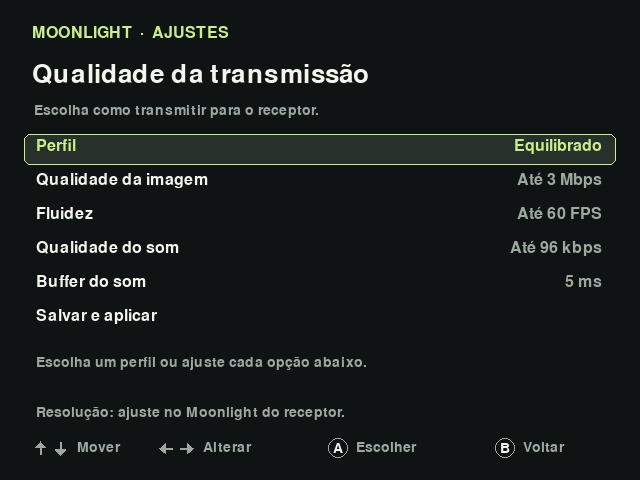

# KNULLI Cast

Transmita a tela e o som do **Anbernic RG35XX SP com KNULLI Scarab** para outro aparelho na rede local e continue jogando com os botões do portátil.

**Protótipo experimental.** Verificado no RG35XX SP com Scarab de 11/05/2026 e um Mac. Pareamento e imagem também foram confirmados em um projetor Android. A latência total não foi medida; outros receptores e portáteis ainda precisam de validação.

## Usar em um portátil que já tem o projeto instalado

1. Conecte o portátil e o receptor à mesma rede Wi-Fi. Mantenha a tampa aberta.
2. No portátil, abra **Ports → Navegador - Transmitir tela**.
3. Confira o IP em **Start → Configurações de rede**.
4. No navegador do computador, Android ou projetor, abra `http://IP-DO-PORTATIL:8088`.
5. Pressione **Assistir**, deixe **Transmitir som** marcado e abra um jogo no portátil.
6. Use **Tela cheia** no receptor. Para encerrar o serviço, abra **Ports → Parar transmissão**.

O receptor precisa de um navegador compatível com WebRTC/H.264 e reprodução de áudio. Uma TV com um navegador antigo pode não funcionar. Para receptores com Moonlight, existe também o modo abaixo.

## Usar com Moonlight

1. Instale o [Moonlight oficial](https://moonlight-stream.org/) no **aparelho que receberá a imagem**.
2. No portátil, abra **Ports → Moonlight - Transmitir tela**.
3. No Moonlight do receptor, adicione o IP do portátil, **sem `:8088`**.
4. Selecione **KNULLI RG35XX SP**. No primeiro acesso, o receptor mostra um PIN.
5. Digite esse PIN na tela de pareamento do portátil: esquerda/direita escolhem a posição, cima/baixo alteram o número e **A** confirma.
6. No receptor, abra **Tela do KNULLI**. Volte ao menu do portátil quando a tela de pareamento fechar e escolha o jogo.

O pareamento é feito uma vez por receptor. No teste com Mac, usamos **640 × 480, 60 FPS, H.264 e 3 Mbps**. Em Android/TV que não ofereça 640 × 480, 720p/60 é uma configuração inicial para testar, sem garantia de desempenho.

**Use um modo de cada vez.** Iniciar Moonlight encerra o modo navegador; iniciar navegador encerra o servidor Moonlight.

## Ajustar a transmissão no próprio portátil

Abra **Ports → Moonlight - Ajustes**. Use cima/baixo para escolher uma opção e esquerda/direita para alterar. Em **Salvar e aplicar**, confirme com A. Se o transmissor estiver ligado, ele será reiniciado e será preciso reconectar o Moonlight no receptor. Os pareamentos e os jogos são preservados.

| Perfil | Imagem, até | Fluidez, até | Som, até | Buffer solicitado |
| --- | --- | --- | --- | --- |
| Mais rápido | 1,5 Mbps | 60 FPS | 64 kbps | 5 ms |
| Equilibrado | 3 Mbps | 60 FPS | 96 kbps | 5 ms |
| Mais qualidade | 5 Mbps | 60 FPS | 192 kbps | 5 ms |
| Rede fraca | 1 Mbps | 30 FPS | 64 kbps | 10 ms |

Imagem, fluidez, qualidade do som e buffer também podem ser ajustados separadamente. Esses valores são limites do transmissor; valores menores pedidos pelo receptor continuam sendo respeitados. A resolução continua sendo escolhida no Moonlight do receptor. Mais bitrate reduz a compressão, sem criar detalhes além da tela original.

O buffer em milissegundos é um ajuste da captura do áudio, não uma medição do atraso total. Atraso e estabilidade também dependem da rede e do receptor. Os ajustes se aplicam ao modo **Moonlight** e ficam salvos no cartão; o modo navegador mantém sua configuração própria.

## Qual caminho usar

| Aparelho receptor | Caminho | Validação deste projeto |
| --- | --- | --- |
| Mac | Navegador ou Moonlight | Ambos testados |
| Windows / Linux | Navegador ou Moonlight | Pendente |
| Celular / tablet Android | Navegador compatível ou Moonlight Android | Pendente |
| TV / projetor com Android | Navegador compatível ou Moonlight | Pendente |
| Projetor sem Android | Computador ou receptor compatível ligado à entrada HDMI | Depende do receptor |
| Outro portátil / outro sistema | Exige adaptação e testes do transmissor | Pendente |

## Instalação e documentação

- [Passo a passo para cada receptor](docs/USO.md)
- [Instalação em outro RG35XX SP](docs/INSTALACAO.md)
- [Compilar o servidor Moonlight](docs/COMPILACAO.md)
- [Arquitetura, resultados e limitações](docs/TECNICO.md)
- [Origem do código e licenças](NOTICE.md)

O código do navegador fica em `handheld/`. A pasta `native/` fornece as [fontes completas do servidor Moonlight](native/rgsp-cast-knulli-source.tar.gz), com SHA-256, e um [patch das adaptações Rust](native/KNULLI.patch). O script `scripts/prepare_native.py` confere e extrai as fontes antes da compilação. Os executáveis `go2rtc` e `moonlight-host`, as bibliotecas proprietárias CedarC, ROMs, BIOS, certificados e registros de pareamento não ficam no Git. As ferramentas NextUI no arquivo de fontes pertencem ao projeto original; **use as instruções KNULLI deste README**.

## Como funciona

**Botões do portátil → jogo no RG35XX SP → Wi-Fi → imagem e som no receptor.**

O navegador usa vídeo WebRTC e áudio PCM estéreo com uma fila curta; Opus/WebRTC é a alternativa automática quando o áudio direto não funciona. O modo Moonlight usa o protocolo GameStream com captura adaptada ao KNULLI. Os jogos continuam rodando no portátil. Controle remoto pelos botões do receptor não foi implementado.

## Licença

GPL-3.0-only para esta adaptação, preservando os avisos e licenças das dependências e do código de terceiros. Veja [LICENSE](LICENSE), [NOTICE.md](NOTICE.md) e [THIRD-PARTY-LICENSES.txt](THIRD-PARTY-LICENSES.txt).

Este é um projeto independente. Compatibilidade com outros aparelhos e versões do KNULLI precisa ser demonstrada por testes.
